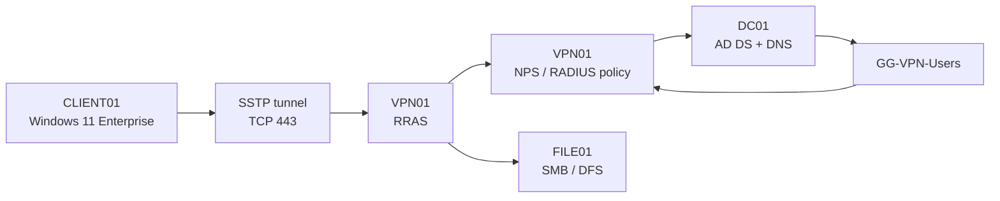

# Lab 02 — Network Services: RRAS VPN and NPS

**Date performed:** 13–14 October 2026

**Status:** Completed and validated

**Related areas:** Windows Server networking, RRAS, SSTP VPN, Network Policy Server (NPS), RADIUS, Active Directory authorization, certificates, routing, and troubleshooting

## Objective

Deploy and validate a domain-integrated Windows Server remote-access VPN that uses RRAS for the SSTP tunnel, NPS for policy-based authorization, and Active Directory security groups for access control.

The lab also demonstrates an end-to-end routed SMB test through the VPN tunnel, including positive and negative NPS authorization evidence and cleanup of temporary routing and test data.

## Business Scenario

A domain user needs secure remote access to internal Windows Server resources without exposing SMB, RDP, or management ports directly to the Internet. The VPN gateway must authenticate against the existing Active Directory environment and restrict access to an explicitly authorized security group.

This homelab deployment keeps RRAS and NPS on the same Windows Server VM to reduce resource usage while still demonstrating the logical separation between:

- the VPN endpoint and tunnel service;
- the RADIUS/NPS policy engine;
- Active Directory identity and group membership;
- the internal resource being accessed.

No public home IP address, RADIUS shared secret, password, or private key is stored in this repository.

## Scope

This completed block covers:

- deployment of the `VPN01` Generation 2 virtual machine on `HV-HOST01`;
- Windows Server 2025 Standard Evaluation with Desktop Experience;
- domain join and placement in the existing Member Servers OU;
- a static server address outside the router DHCP pool;
- internal AD DNS through `DC01`;
- installation of Remote Access, VPN/RAS, Routing, and NPAS/NPS roles;
- RRAS configured for VPN access;
- NPS registration in Active Directory;
- a dedicated `GG-VPN-Users` authorization group;
- RRAS/NPS policy configuration for MS-CHAPv2 user authentication;
- a dedicated RRAS static client-address pool outside the router DHCP range;
- an SSTP server certificate bound to RRAS;
- certificate trust established on `CLIENT01`;
- an all-users Windows SSTP profile on `CLIENT01`;
- positive VPN authorization for `PETROVIC\vladimir.petrovic`;
- negative VPN authorization for `PETROVIC\adm-vpetrovic`;
- NPS Security events 6272 (grant) and 6273 (deny);
- server-side RRAS connection statistics;
- a temporary host route forcing `FILE01` SMB traffic through the SSTP interface;
- SMB TCP/445 validation with the VPN address as the source;
- read/write/delete validation through the existing DFS path;
- cleanup of the temporary host route, test file, and active VPN session.

Internet-facing router port forwarding, public DNS publication, production PKI, Always On VPN, MFA, IKEv2, DHCP Server deployment, and external-client validation are outside this completed block.

## Environment

| Component | Configuration |
|---|---|
| Hyper-V host | `HV-HOST01` |
| Virtual switch | `vSwitch-External` |
| VPN server | `VPN01`, Windows Server 2025 Standard Evaluation, Desktop Experience |
| VM generation | Generation 2 |
| VM CPU | 2 vCPU |
| VM memory | Dynamic: 1 GB minimum, 2 GB startup, 3 GB maximum |
| OS disk | 60 GB dynamically expanding VHDX |
| Automatic checkpoints | Disabled |
| Domain | `ad.petrovicinfra.com` (`PETROVIC`) |
| Computer OU | `OU=Member Servers,OU=Servers,OU=PetrovicInfra,DC=ad,DC=petrovicinfra,DC=com` |
| AD/DNS server | `DC01` |
| File server | `FILE01` |
| Validation client | `CLIENT01`, Windows 11 Enterprise |
| VPN protocol | SSTP |
| User authentication | MS-CHAPv2 |
| Authorization group | `GG-VPN-Users` |
| NPS policy | `VPN01 VPN Connections` |
| RRAS client-address assignment | Dedicated static pool outside the router DHCP range |
| Client VPN profile | `PetrovicInfra SSTP` |
| VPN server name | `vpn01.ad.petrovicinfra.com` |
| Internal validation resource | `\\ad.petrovicinfra.com\Shares\IT` / SMB TCP 445 |

## Architecture



The roles are logically distinct even though RRAS and NPS run on the same VM:

```text
VPN client
    -> RRAS: terminates the VPN tunnel
        -> NPS: evaluates authentication and authorization policy
            -> Active Directory: validates identity and group membership
                -> internal Windows Server resources
```

## Success Criteria

- `VPN01` is a domain member in the existing Member Servers OU.
- `VPN01` uses internal AD DNS and maintains a healthy domain secure channel.
- Remote Access, DirectAccess/VPN (RAS), Routing, and NPAS roles are installed.
- RRAS and NPS services run automatically.
- NPS is registered in Active Directory.
- `GG-VPN-Users` controls VPN authorization.
- The standard user can connect through SSTP.
- The privileged admin account is denied when it is not a member of `GG-VPN-Users`.
- NPS logs a 6272 grant for the allowed user and a 6273 deny for the unauthorized user.
- RRAS assigns a client address from the dedicated VPN pool.
- The SSTP server certificate is trusted by the Windows client.
- TCP 443 from `CLIENT01` to the VPN server succeeds.
- A temporary `/32` route can force FILE01 traffic through the SSTP interface.
- SMB TCP 445 succeeds with the VPN adapter address as the source.
- The standard user can write, read, and delete a test file through the existing DFS path while the FILE01 host route is forced through the VPN.
- The temporary route and test file are removed and the VPN session is disconnected after validation.

## Implementation

### 1. Pre-check the Hyper-V host

Before creating a new VM, host memory, existing VMs, the external switch, default storage paths, available installation media, and free datastore capacity were checked.

The host had approximately 20 GB of installed RAM and sufficient free memory and storage for a small additional Windows Server VM. `VPN01` did not already exist.

The existing storage model was preserved:

```text
V:\Hyper-V\Virtual Machines
V:\Hyper-V\Virtual Hard Disks
V:\ISO
```

No existing VM or disk was recreated.

### 2. Create the VPN01 VM

`VPN01` was created as a Generation 2 VM with:

```text
2 vCPU
Dynamic memory: 1 GB minimum / 2 GB startup / 3 GB maximum
60 GB dynamic OS VHDX
vSwitch-External
Automatic checkpoints disabled
```

Windows Server 2025 Standard Evaluation with Desktop Experience was installed to make the first RRAS/NPS implementation and troubleshooting workflow visible through both MMC consoles and PowerShell.

### 3. Configure networking and join the domain

The VM initially received a DHCP address from the LAN router. Before domain join, AD DNS resolution was validated directly against `DC01`, including the LDAP SRV record for the domain.

The server was then configured with a static address outside the router DHCP scope, the LAN gateway, and `DC01` as the IPv4 DNS server.

Because the router was also advertising itself as an IPv6 DNS server, the IPv6 binding on the `VPN01` Ethernet adapter was disabled for this IPv4-only homelab. This was an intentional lab decision based on an earlier DNS-path issue; it is not a general recommendation to disable IPv6 in production.

`VPN01` was renamed, joined to `ad.petrovicinfra.com`, and placed directly in:

```text
OU=Member Servers,OU=Servers,OU=PetrovicInfra,DC=ad,DC=petrovicinfra,DC=com
```

Validation included:

```powershell
Get-CimInstance Win32_ComputerSystem |
    Select-Object Name,Domain,PartOfDomain

Test-ComputerSecureChannel -Verbose

nltest /dsgetdc:ad.petrovicinfra.com
```

The secure channel returned `True` and DC Locator found `DC01`.

### 4. Install RRAS and NPS roles

The required roles were installed with:

```powershell
Install-WindowsFeature `
    DirectAccess-VPN,Routing,NPAS `
    -IncludeManagementTools
```

Validation confirmed these features as installed:

```text
RemoteAccess
DirectAccess-VPN
Routing
NPAS
```

The first installation attempt failed because PowerShell was not elevated. No feature change occurred during that attempt. The same command succeeded after opening an elevated administrator session.

RRAS was then enabled through a Custom Configuration with **VPN access** selected.

The `RemoteAccess` and `IAS` services were validated as `Running` with `Automatic` startup.

### 5. Create the VPN authorization group

A dedicated AD security group was created in the existing Global groups OU:

```text
GG-VPN-Users
Security / Global
```

`vladimir.petrovic` was added as the allowed VPN user.

The privileged `adm-vpetrovic` account was deliberately left outside this group so it could be used for the negative authorization test.

### 6. Register and configure NPS

NPS was registered in Active Directory. Validation confirmed the `VPN01$` computer account as a member of the built-in:

```text
RAS and IAS Servers
```

A RADIUS client was created for RRAS:

```text
Friendly name: VPN01-RRAS
Device manufacturer: RADIUS Standard
Status: Enabled
```

The RADIUS shared secret is intentionally not documented.

The NPS VPN wizard created the policy path used by this lab. The completed authorization policy was:

```text
Network Policy: VPN01 VPN Connections
Processing order: 1
Access type: Grant Access
Allowed group: PETROVIC\GG-VPN-Users
Authentication method: MS-CHAPv2
```

Because NPS and RRAS are installed on the same server, RRAS displays a notice that authentication and accounting providers are managed through NPS Connection Request Policies. The separate `Authentication provider: RADIUS Authentication` dropdown used by split-server deployments is therefore not used in this topology.

The existing Microsoft Routing and Remote Access Service connection-request policy was retained.

### 7. Configure the RRAS client-address pool

A small static address pool outside the router DHCP range was checked for conflicts and then assigned to RRAS.

The first address in the pool was observed on the server-side RAS interface. Client sessions received subsequent `/32` addresses from the same pool.

This behavior was confirmed with:

```powershell
Get-NetIPAddress -AddressFamily IPv4
```

and with `ipconfig` on `CLIENT01`.

### 8. Configure the SSTP certificate

No existing suitable server certificate was present in `Cert:\LocalMachine\My`.

A lab-only self-signed certificate was created for:

```text
vpn01.ad.petrovicinfra.com
```

with:

```text
Type: SSL Server Authentication
RSA: 2048 bit
Hash: SHA-256
EKU: Server Authentication
Private key: present only on VPN01
Validity: two years
```

The certificate was selected under RRAS SSL Certificate Binding and RRAS was restarted.

Only the public `.cer` file was exported for client trust. The private key was not exported.

The public certificate was imported on `CLIENT01` into:

```text
Cert:\LocalMachine\Root
```

The first certificate import attempt failed with `Access is denied` because the PowerShell session was not elevated. The import succeeded after reopening PowerShell as an administrator.

### 9. Validate SSTP reachability

Before creating the client VPN profile, `CLIENT01` validated:

```powershell
Resolve-DnsName 'vpn01.ad.petrovicinfra.com'

Test-NetConnection `
    'vpn01.ad.petrovicinfra.com' `
    -Port 443
```

DNS resolved the VPN server correctly and TCP 443 returned `TcpTestSucceeded = True`.

### 10. Create the Windows VPN client profile

An all-users SSTP profile was created on `CLIENT01`:

```powershell
Add-VpnConnection `
    -Name 'PetrovicInfra SSTP' `
    -ServerAddress 'vpn01.ad.petrovicinfra.com' `
    -TunnelType Sstp `
    -AuthenticationMethod MSChapv2 `
    -EncryptionLevel Required `
    -AllUserConnection `
    -Force
```

The profile initially showed `Disconnected`, with the expected SSTP and MS-CHAPv2 settings.

## Validation

### Positive authorization test

`PETROVIC\vladimir.petrovic` connected successfully through `PetrovicInfra SSTP`.

Client-side evidence included:

```text
ConnectionStatus : Connected
TunnelType       : Sstp
```

and a PPP adapter address from the dedicated RRAS pool.

Server-side evidence from:

```powershell
Get-RemoteAccessConnectionStatistics
```

showed the authenticated domain user, the assigned VPN address, `Sstp`, and the connection start time.

NPS logged Security Event **6272**:

```text
Network Policy Server granted access to a user.
Account Name: PETROVIC\vladimir.petrovic
NAS Identifier: VPN01
```

This proves the connection was not accepted merely because RRAS was listening: the NPS policy authorized the user.

### Negative authorization test

The VPN session was disconnected and the same profile was tested with:

```text
PETROVIC\adm-vpetrovic
```

That account is not a member of `GG-VPN-Users`.

The VPN connection was denied and NPS logged Security Event **6273**.

This validates that the policy is group-based and that a privileged domain account does not receive VPN access simply because it has administrative rights elsewhere.

### Routed SMB test through the VPN tunnel

`CLIENT01` is physically attached to the same lab LAN as `FILE01`, so a normal SMB test would not prove the packet used the VPN.

A temporary host route was therefore created for the `FILE01` address only:

```powershell
New-NetRoute `
    -DestinationPrefix '192.168.1.12/32' `
    -InterfaceIndex $vpn.InterfaceIndex `
    -NextHop '0.0.0.0' `
    -RouteMetric 1 `
    -PolicyStore ActiveStore
```

The `/32` prefix forced only the FILE01 host through the SSTP point-to-point interface.

Validation:

```powershell
Test-NetConnection `
    192.168.1.12 `
    -Port 445 `
    -InformationLevel Detailed
```

returned:

```text
InterfaceAlias    : PetrovicInfra SSTP
SourceAddress     : VPN client address
RemotePort        : 445
TcpTestSucceeded  : True
```

The important evidence is that the source address belonged to the SSTP interface rather than the physical Ethernet adapter.

### SMB read/write/delete test as the standard user

With the FILE01 `/32` route active, a non-elevated PowerShell session was opened as:

```text
PETROVIC\vladimir.petrovic
```

The test used the existing DFS path:

```powershell
$TestFile = '\\ad.petrovicinfra.com\Shares\IT\VPN-Tunnel-Test.txt'

Set-Content $TestFile 'VPN SSTP test'
Get-Content $TestFile
Remove-Item $TestFile
Test-Path $TestFile
```

Results:

```text
VPN SSTP test
False
```

This confirms write, read, delete, and cleanup while FILE01 traffic was explicitly forced through the VPN interface.

An earlier SMB test was performed from an elevated `adm-vpetrovic` shell. It proved transport but not the intended standard-user security context, so it was not used as the final user-access evidence. The test was repeated under `vladimir.petrovic` for the final PASS.

## Cleanup

The temporary FILE01 `/32` route was removed:

```powershell
Remove-NetRoute `
    -DestinationPrefix '192.168.1.12/32' `
    -InterfaceIndex $vpn.InterfaceIndex `
    -Confirm:$false
```

A subsequent route query returned no matching route.

The SMB test file was removed and `Test-Path` returned `False`.

The SSTP session was disconnected:

```powershell
rasdial "PetrovicInfra SSTP" /disconnect
```

`Get-VpnConnection` reported `Disconnected`, and `Get-RemoteAccessConnectionStatistics` returned no active sessions.

The following items remain intentionally because they are the durable result of the lab:

- the `VPN01` VM;
- RRAS and NPS configuration;
- `GG-VPN-Users`;
- NPS policies and AD registration;
- the SSTP server certificate and client trust;
- the `PetrovicInfra SSTP` Windows VPN profile;
- the RRAS static client-address pool.

Temporary exported certificate-file copies were used only as a transport mechanism; deletion of every transport copy was not captured as separate evidence and is not claimed here.

## Troubleshooting and Lessons Learned

### PowerShell elevation matters

Both Windows feature installation and Local Machine certificate-store changes require an elevated token. Domain administrative membership alone does not make a non-elevated PowerShell process unrestricted under UAC.

### RRAS and NPS on the same server behave differently from split-server examples

Many examples show RRAS configured with an explicit `RADIUS Authentication` provider and an external NPS address. With NPS installed locally, the RRAS UI instead directs authentication and accounting configuration to NPS Connection Request Policies.

### NPS grant and deny events must both be queried

A query filtered only for Security Event 6272 continued to show the earlier successful user even after a later denied attempt. Querying both 6272 and 6273 exposed the current positive and negative authorization results.

### Connected does not prove routed application traffic

Because `CLIENT01` and `FILE01` share the physical lab subnet, direct Ethernet access could make SMB appear successful even if the VPN route was not used.

The temporary `/32` route and the observed VPN `SourceAddress` provided the missing proof.

### Security context must be explicit

The first SMB application test was run from an administrative shell. The transport result was valid, but it did not prove standard-user access. The write/read/delete test was therefore repeated in a non-elevated `vladimir.petrovic` session.

### DNS path must be controlled before domain operations

The server initially received the router as its DNS server. AD DNS was validated first and then set explicitly to `DC01`. The router-provided IPv6 DNS path was removed from this IPv4-only lab to avoid repeating the earlier split DNS behavior.

## Security Notes

- No RDP, SMB, WinRM, or WAC management port was exposed directly to the Internet.
- The RADIUS shared secret is not stored in the repository.
- Passwords are not stored in scripts or documentation.
- The SSTP private key remains on `VPN01`.
- The self-signed certificate is a homelab trust model, not a production PKI recommendation.
- MS-CHAPv2 is used here to demonstrate the RRAS/NPS policy chain; stronger certificate/EAP/MFA designs remain future hardening work.
- Public router/NAT validation after relocation remains a separate task.

## Limitations and Next Steps

This completed block validates Windows Server RRAS, SSTP, NPS/RADIUS policy, Active Directory group authorization, certificate trust, and routed access to an internal SMB service.

It does **not** demonstrate:

- an external Internet client traversing the home router;
- production CA-issued certificates;
- Always On VPN;
- IKEv2;
- MFA;
- redundant VPN gateways;
- NPS high availability;
- DHCP Server deployment or DHCP HA;
- physical host high availability.

The next infrastructure-resilience milestone remains the planned `HV-HOST02` bring-up and later `DC02` deployment when the second host has its required power supply. Windows LAPS/workstation hardening and DHCP remain separate planned blocks.
