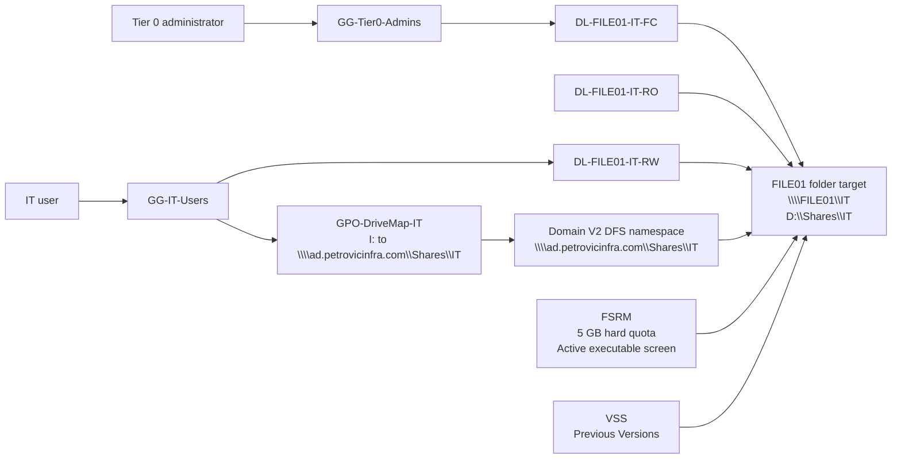

# Lab 04 — FILE01 File Services

**Date performed:** 6, 11, and 12 October 2026

**Status:** Completed and validated

**Related AZ-802 areas:** Windows Server file services, storage, SMB, NTFS permissions, AGDLP, FSRM, DFS Namespaces, Group Policy Preferences, and data recovery

## Objective

Deploy a domain-integrated Windows Server file server with separate data storage, role-based access control, storage governance, a stable domain-based DFS access path, user drive mapping, and a tested previous-version recovery workflow.

## Business Scenario

The IT department needs a centrally managed file share that separates user roles from resource permissions. The service must limit uncontrolled storage growth, prevent executable files from being stored in the share, expose the share consistently to authorized users, and provide a quick recovery path for accidental file changes.

## Scope

This lab covers:

- domain join and placement of `FILE01` in the existing server OU structure;
- a dedicated 40 GB dynamically expanding data VHDX on the `HV-HOST01` `V:` datastore;
- an NTFS `D:` volume labelled `Data`;
- the File Server and File Server Resource Manager roles;
- the `D:\Shares\IT` folder and `\\FILE01\IT` SMB share;
- AGDLP-based SMB and NTFS authorization, including positive and negative read-only tests;
- a 5 GB hard quota with a validated exhaustion test and active executable-file screening;
- SMB share Access-Based Enumeration with before/after validation and cleanup;
- Shadow Copies, a scheduled VSS task, and a successful Previous Versions restore;
- the Domain V2 namespace `\\ad.petrovicinfra.com\Shares` with root target `\\FILE01.ad.petrovicinfra.com\DFSRoot$`;
- the DFS folder `\\ad.petrovicinfra.com\Shares\IT` with folder target `\\FILE01\IT`;
- Group Policy Preferences drive mapping from `I:` to `\\ad.petrovicinfra.com\Shares\IT` for `GG-IT-Users`.

DFS Replication, a second namespace server or folder target, high availability, TrueNAS integration, Azure Files, File Sync, and production backup are outside this completed block and remain planned work. `FS-DFS-Replication` was not installed.

## Environment

| Component | Configuration |
|---|---|
| Hyper-V host | `HV-HOST01` |
| VM datastore | `V:` ReFS volume labelled `HyperV-VMs` |
| File server | `FILE01`, joined to `ad.petrovicinfra.com` |
| Computer OU | `OU=File Servers,OU=Servers,OU=PetrovicInfra,DC=ad,DC=petrovicinfra,DC=com` |
| Data disk | 40 GB dynamically expanding VHDX on the host `V:` datastore |
| Guest data volume | `D:`, NTFS, label `Data` |
| Share folder | `D:\Shares\IT` |
| UNC path | `\\FILE01\IT` |
| Share enumeration | `FolderEnumerationMode = AccessBased` |
| Quota after test cleanup | 5 GB hard limit, `SoftLimit=False`, `UsageMB=0.01` |
| DFS namespace | `\\ad.petrovicinfra.com\Shares` (domain-based, Domain V2, Online) |
| DFS root target | `\\FILE01.ad.petrovicinfra.com\DFSRoot$` |
| DFS folder target | `\\ad.petrovicinfra.com\Shares\IT` → `\\FILE01\IT` |
| Management server | `MGMT01` |
| Validation client | `CLIENT01`, tested as `PETROVIC\vladimir.petrovic` |
| Test user role | `GG-IT-Users` |
| Privileged role | `GG-Tier0-Admins` |

## Architecture



The authorization design follows AGDLP:

```text
Account
    -> Global role group
        -> Domain Local resource group
            -> SMB and NTFS permission
```

No direct user permissions were assigned to the share folder.

The namespace has one namespace server/root target and one folder target. It provides a stable domain-based access path, but it does not provide DFS Replication or high availability.

## Success Criteria

- `FILE01` is a domain member in the confirmed File Servers OU.
- The file server uses a dedicated 40 GB dynamic data disk rather than the operating-system volume.
- `D:\Shares\IT` is available as `\\FILE01\IT`.
- IT users receive access through `GG-IT-Users` and `DL-FILE01-IT-RW`.
- Tier 0 administrators receive full control through `GG-Tier0-Admins` and `DL-FILE01-IT-FC`.
- The NTFS ACL contains only the required administrative, system, and Domain Local group entries.
- The SMB ACL grants the intended Full, Change, and Read permission tiers.
- The read-only test identity can read while create, modify, and delete operations are denied.
- FSRM enforces a 5 GB hard quota and blocks executable files.
- Writes exceeding the hard quota are rejected, and test data is removed afterward.
- ABE hides inaccessible test folders after the SMB session is refreshed, while permitted folders remain accessible.
- VSS creates shadow copies for `D:` and a previous file version can be restored.
- The Domain V2 namespace is Online and `\\ad.petrovicinfra.com\Shares\IT` resolves to the existing `\\FILE01\IT` folder target.
- Authorized IT users receive `I:` through Group Policy Preferences mapped to `\\ad.petrovicinfra.com\Shares\IT`.
- `CLIENT01` can read, write, and delete a test file through the DFS-mapped drive, and cleanup leaves no test file behind.

## Implementation

### 1. Join FILE01 to the domain and place it in the server OU

`FILE01` was joined to `ad.petrovicinfra.com`. Its computer object was moved into the existing OU path:

```text
OU=File Servers,OU=Servers,OU=PetrovicInfra,DC=ad,DC=petrovicinfra,DC=com
```

This keeps server policy scope aligned with the established OU architecture; no new OU branch was introduced.

### 2. Add and prepare the dedicated data disk

A 40 GB dynamically expanding VHDX was created on the `HV-HOST01` `V:` datastore and attached to `FILE01`. Inside the guest, the disk was initialized, partitioned, and formatted as NTFS with drive letter `D:` and volume label `Data`.

The data layout is intentionally separate from the guest operating system:

```text
FILE01
├── C:  Operating system
└── D:  Data
    └── Shares
        └── IT
```

### 3. Install file services and create the IT share

The File Server role was installed and the departmental folder was created at:

```text
D:\Shares\IT
```

The folder was published as:

```text
\\FILE01\IT
```

### 4. Implement the AGDLP authorization model

The existing Global groups represent directory roles. Resource-specific Domain Local groups represent permission levels on `FILE01`.

| Global group | Nested into | Effective resource role |
|---|---|---|
| `GG-IT-Users` | `DL-FILE01-IT-RW` | Read/write access to the IT share |
| `GG-Tier0-Admins` | `DL-FILE01-IT-FC` | Full control of the IT share |

`DL-FILE01-IT-RO` provides the read-only resource tier. The 11 October validation temporarily used `file01-ro-test` → `GG-IT-RO-Test` → `DL-FILE01-IT-RO`. The temporary user and Global group were removed after the tests; the Domain Local resource tier was retained.

The resulting primary access paths are:

```text
vladimir.petrovic
    -> GG-IT-Users
        -> DL-FILE01-IT-RW
            -> SMB Change + NTFS Modify

adm-vpetrovic
    -> GG-Tier0-Admins
        -> DL-FILE01-IT-FC
            -> SMB Full + NTFS Full Control
```

### 5. Clean the NTFS ACL

Default broad entries were removed from the share root. The resulting ACL retained only the required principals and permission tiers.

| Principal | NTFS permission |
|---|---|
| `BUILTIN\Administrators` | Full Control |
| `NT AUTHORITY\SYSTEM` | Full Control |
| `PETROVIC\DL-FILE01-IT-FC` | Full Control |
| `PETROVIC\DL-FILE01-IT-RW` | Modify |
| `PETROVIC\DL-FILE01-IT-RO` | Read & Execute |

The ACL is resource-group based: access is not assigned directly to individual users.

### 6. Configure SMB permissions

The share permissions mirror the three Domain Local resource tiers.

| Principal | SMB permission |
|---|---|
| `PETROVIC\DL-FILE01-IT-FC` | Full |
| `PETROVIC\DL-FILE01-IT-RW` | Change |
| `PETROVIC\DL-FILE01-IT-RO` | Read |

Effective network access is the most restrictive combination of SMB and NTFS permissions.

### 7. Configure FSRM quota and file screening

File Server Resource Manager was installed. A 5 GB hard quota was applied to `D:\Shares\IT`. Because the quota is hard, writes are blocked when the limit is reached instead of only generating a warning.

An active file screen was created by using the built-in `Executable Files` file group:

```powershell
New-FsrmFileScreen `
    -Path "D:\Shares\IT" `
    -IncludeGroup "Executable Files" `
    -Active `
    -Description "Block executable files on IT share"
```

The active screen controls file types independently of identity permissions: AGDLP determines who can write, while FSRM determines which file types may be stored.

### 8. Enable Shadow Copies and schedule VSS snapshots

Shadow storage for `D:` was configured on the same volume with a 4 GB maximum:

```powershell
vssadmin add shadowstorage /for=D: /on=D: /maxsize=4GB
vssadmin create shadow /for=D:
```

The scheduled task `FILE01-Daily-ShadowCopies` runs as `SYSTEM` with highest privileges and creates two snapshots per day:

```text
08:00
18:00
```

The task action runs:

```text
vssadmin.exe create shadow /for=D:
```

### 9. Map the IT share through Group Policy Preferences

The GPO `GPO-DriveMap-IT` was linked to the existing `OU=PetrovicInfra` scope. It originally mapped the drive directly to `\\FILE01\IT`. After DFS Namespace validation, only the existing item's Location was changed to the stable domain-based DFS path. The drive map is configured under:

```text
User Configuration
└── Preferences
    └── Windows Settings
        └── Drive Maps
```

| Setting | Value |
|---|---|
| Action | Update |
| Location | `\\ad.petrovicinfra.com\Shares\IT` |
| Label | `IT` |
| Drive letter | `I:` |
| Reconnect | Enabled |
| Item-level targeting | User is a member of `PETROVIC\GG-IT-Users` |

The GPO retained normal `Authenticated Users` security filtering. Item-level targeting controls which users receive the mapping.

### 10. Add the domain-based DFS Namespace

DFS Namespaces was configured on `FILE01` without installing DFS Replication. The confirmed namespace configuration is:

| Setting | Value |
|---|---|
| Namespace type | Domain-based |
| Namespace mode | Domain V2 |
| Namespace path | `\\ad.petrovicinfra.com\Shares` |
| State | Online |
| Namespace server | `FILE01` |
| Root target | `\\FILE01.ad.petrovicinfra.com\DFSRoot$` |
| DFS folder | `\\ad.petrovicinfra.com\Shares\IT` |
| Folder target | `\\FILE01\IT` |
| DFS Replication role service | `FS-DFS-Replication` not installed |

The existing SMB share, NTFS ACL, SMB permissions, and AGDLP group nesting were not changed. DFS adds an access layer in front of the same protected resource:

```text
PETROVIC\vladimir.petrovic
    -> GG-IT-Users
        -> GPO-DriveMap-IT
            -> I: / \\ad.petrovicinfra.com\Shares\IT
                -> DFS folder target \\FILE01\IT
                    -> D:\Shares\IT
                        -> DL-FILE01-IT-RW
                            -> SMB Change + NTFS Modify
```

### 11. Validate read-only access, quota exhaustion, and ABE

These tests were completed on 11 October, before the 12 October DFS block:

- Read-only access: the temporary `FILE01 RO Test` account (`file01-ro-test`) used `GG-IT-RO-Test` nested into `DL-FILE01-IT-RO`. Read succeeded; create, modify, and delete operations were denied.
- Hard-quota exhaustion: a write beyond the 5 GB hard limit was rejected with `There is not enough space on the disk`. After cleanup, the quota remained 5 GB with `SoftLimit=False` and usage returned to `0.01 MB`.
- ABE: `ABE-RW-Test` and `ABE-RO-Test` used separate resource-group ACLs for `DL-FILE01-IT-RW` and `DL-FILE01-IT-RO`. Each identity could access its permitted folder and was denied access to the other. After the SMB session was refreshed, the RO identity no longer saw the inaccessible RW folder in the directory listing. The `IT` share remained configured as `AccessBased`.

Cleanup removed `ABE-RW-Test`, `ABE-RO-Test`, and `RO-Validation.txt`; the earlier `previous-version-test.txt` remained. `GG-IT-RO-Test` was removed from `DL-FILE01-IT-RO`, and the temporary user and Global group were deleted. The existing SMB share, quota, ABE setting, and resource-group authorization model were retained.

## Validation

| Test | Expected result | Observed result | Status |
|---|---|---|---|
| Domain and OU placement | `FILE01` is a domain member in the File Servers OU | Confirmed in the established OU path | PASS |
| Data storage | Dedicated 40 GB dynamic VHDX is exposed as NTFS `D:` / `Data` | Volume available and used for share data | PASS |
| SMB availability | `\\FILE01\IT` is reachable | Share opened successfully | PASS |
| RW authorization | IT user can create and read a file through the AGDLP chain | User write/read test succeeded | PASS |
| RO positive/negative | Read succeeds; create, modify, and delete fail | Completed with `file01-ro-test` through the RO AGDLP chain on 11 October | PASS |
| FSRM allowed type | A normal text file can be created | `.txt` creation succeeded | PASS |
| FSRM blocked type | An executable file is rejected | `.exe` creation was blocked | PASS |
| Hard-quota exhaustion | A write exceeding the 5 GB hard limit is rejected | Write rejected; final limit 5 GB, `SoftLimit=False`, cleanup usage `0.01 MB` | PASS |
| ABE before/after | Inaccessible folders are hidden while permitted folders remain usable | RW/RO boundaries validated; inaccessible RW folder hidden from RO identity after session refresh; final share mode `AccessBased` | PASS |
| Advanced test cleanup | Temporary file/folder and AD test objects are removed | Test folders/files absent; user/group queries returned no test objects; original data retained | PASS |
| VSS | A shadow copy for `D:` is present | Snapshot created successfully | PASS |
| Previous Versions | Version 1 can be restored after the file is changed to Version 2 | Restore completed successfully | PASS |
| DFS namespace | Domain V2 namespace is Online with the expected root target | `\\ad.petrovicinfra.com\Shares` → `\\FILE01.ad.petrovicinfra.com\DFSRoot$` | PASS |
| DFS folder | The `IT` DFS path resolves to the existing SMB share | `\\ad.petrovicinfra.com\Shares\IT` → `\\FILE01\IT` | PASS |
| Direct DFS UNC access | The authorized user can enumerate the DFS path | `Test-Path` returned `True`; `Get-ChildItem` returned existing content | PASS |
| GPO mapping | Authorized user receives `I:` mapped to the DFS UNC | `net use`, `Get-SmbMapping`, and a new-session `Get-PSDrive` showed `\\ad.petrovicinfra.com\Shares\IT` | PASS |
| DFS-mapped read/write/delete | Test content can be created, read, and deleted through `I:` | Content round trip succeeded on `CLIENT01` | PASS |
| Cleanup | The DFS validation file no longer exists | `Test-Path 'I:\DFS-Test.txt'` returned `False` | PASS |

The confirmed end-to-end user path is:

```text
GG-IT-Users
    -> GPO-DriveMap-IT
        -> I: / \\ad.petrovicinfra.com\Shares\IT
            -> DFS referral / \\FILE01\IT
                -> DL-FILE01-IT-RW
                    -> SMB Change + NTFS Modify
```

The RO, quota-exhaustion, ABE, and advanced cleanup tests passed on 11 October; DFS Namespace/GPP integration and test-file cleanup passed on 12 October. ABE was validated at the SMB share level; a separate DFS namespace ABE setting was not captured.

## Break/Fix Scenario

### ABE enumeration required a refreshed SMB session

The ABE before/after test initially retained an old directory listing in the SMB session. After the session was refreshed, the RO user no longer saw the inaccessible RW test folder. Direct access remained controlled by the test folder ACLs throughout; the final `IT` share state was `AccessBased`. The exact session-refresh command is not present in the available closing record.

### Final inventory was initially run in the wrong console

An initial local check could not find `D:\Shares\IT`, share `IT`, or the FSRM cmdlet because it was run on another computer. Inventory was then directed from `MGMT01` to `FILE01` with `Invoke-Command -ComputerName FILE01`, and the target was confirmed before interpreting the output.

The `IT` row from the subsequent `Get-SmbShare` output was also initially mistaken for a nested data folder. The closing `Get-Item` and `Get-ChildItem` checks returned `PathNotFound` for `D:\Shares\IT\IT`; that folder did not exist. No unexplained folder was deleted.

### NoRun made Explorer Run an invalid DFS test

Opening the UNC path through the Windows Run dialog was blocked. This was not an SMB, NTFS, or DFS failure: the existing `GPO-User-Baseline` intentionally sets `NoRun=1` for the standard user. The restriction and path availability were separated with PowerShell:

```powershell
Get-ItemPropertyValue `
    -Path 'HKCU:\Software\Microsoft\Windows\CurrentVersion\Policies\Explorer' `
    -Name NoRun `
    -ErrorAction SilentlyContinue

Test-Path '\\FILE01\IT'
Test-Path '\\ad.petrovicinfra.com\Shares\IT'
Get-ChildItem '\\ad.petrovicinfra.com\Shares\IT'
```

`NoRun` returned `1`; both `Test-Path` checks returned `True`, and the DFS path returned the existing share content. The baseline GPO was not weakened to test DFS.

### The existing Update drive map did not immediately replace the active connection

After the GPP Location changed, the active `I:` mapping still pointed to `\\FILE01\IT`. A write test at that point proved only the old direct path, so it was not accepted as DFS/GPP evidence. Only the existing client mapping was removed; the share and GPO were not recreated:

```powershell
Get-SmbMapping -LocalPath 'I:'
Remove-SmbMapping -LocalPath 'I:' -Force
Get-SmbMapping -LocalPath 'I:' -ErrorAction SilentlyContinue
gpupdate /target:user /force
Get-SmbMapping -LocalPath 'I:'
Get-PSDrive I
```

`Get-SmbMapping` then showed `\\ad.petrovicinfra.com\Shares\IT`, but `Get-PSDrive I` in the same already-open PowerShell process still displayed the old `\\FILE01\IT` root. This was stale FileSystem PSDrive session state, not a remaining GPO error. The live Windows mapping was confirmed, and the PowerShell view was refreshed by opening a new session:

```powershell
cmd /c "net use I:"
Get-PSDrive I
Get-SmbMapping -LocalPath 'I:'
```

All three checks showed the DFS UNC when `Get-PSDrive` was run in the new PowerShell session.

## PowerShell and Commands Used

The following closing checks were confirmed on `FILE01` as `PETROVIC\adm-vpetrovic` on 11 October. They record completed validation, not instructions to repeat the tests:

```powershell
Get-ChildItem 'D:\Shares\IT' -Force |
    Select-Object Name,Length

Get-SmbShare -Name 'IT' |
    Select-Object Name,Path,FolderEnumerationMode

Get-FsrmQuota -Path 'D:\Shares\IT' |
    Select-Object Path,
        @{N='LimitGB';E={[math]::Round($_.Size/1GB,2)}},
        @{N='UsageMB';E={[math]::Round($_.Usage/1MB,2)}},
        SoftLimit
```

Observed final state: `IT` → `D:\Shares\IT`, `AccessBased`, 5 GB, `0.01 MB`, and `SoftLimit=False`.

The confirmed AD cleanup used the privileged management identity `PETROVIC\adm-vpetrovic`. The closing screenshot does not identify the exact computer:

```powershell
Remove-ADGroupMember `
    -Identity 'DL-FILE01-IT-RO' `
    -Members 'GG-IT-RO-Test' `
    -Confirm:$false
Remove-ADUser 'file01-ro-test' -Confirm:$false
Remove-ADGroup 'GG-IT-RO-Test' -Confirm:$false
Get-ADGroupMember 'DL-FILE01-IT-RO'
Get-ADUser -Filter "SamAccountName -eq 'file01-ro-test'"
Get-ADGroup -Filter "SamAccountName -eq 'GG-IT-RO-Test'"
```

The final queries returned no test user/group or remaining test-group membership. The original quota test generator, temporary-account DN/OU/UPN, and full temporary folder ACL command lines are not available in the closing record and have not been reconstructed as executed commands.

The final end-to-end validation was run on `CLIENT01` as `PETROVIC\vladimir.petrovic` after the GPP remap:

```powershell
'DFS namespace validation after GPP remap' |
    Set-Content 'I:\DFS-Test.txt'

Get-Content 'I:\DFS-Test.txt'
Remove-Item 'I:\DFS-Test.txt'
Test-Path 'I:\DFS-Test.txt'
```

The content read succeeded and the final cleanup check returned `False`.

## Security and Safety Notes

- Access is assigned to Domain Local resource groups, not directly to users.
- Standard and privileged identities use separate Global groups and separate permission paths.
- Broad default NTFS entries were removed from the share root.
- Active file screening reduces the risk of storing executable content but is not malware protection.
- Shadow Copies are stored on the same `D:` disk as live data. They support rapid recovery from accidental changes but do not replace an independent backup.
- The domain-based namespace provides a stable client path; with one namespace server and one folder target it does not provide availability during a `FILE01` outage.
- DFS Replication was deliberately not installed or claimed as part of this namespace-only block.
- Credentials, VM disks, and unsanitized exports are not stored in this repository.

## Lessons Learned

- AGDLP keeps organizational roles independent from resource-specific permissions and makes the ACL easier to audit.
- SMB and NTFS permissions must be designed together because effective network access is the more restrictive result.
- Separating the data VHDX from the operating-system disk simplifies capacity management and future recovery work.
- FSRM quotas and file screening address different controls: capacity and allowed file types.
- ABE changes what users see in a directory listing; the SMB and NTFS permissions still control access. Refreshing the SMB session helped distinguish a cached listing from the final ABE result.
- Group Policy Preferences with item-level targeting can provide a consistent drive letter without changing GPO security filtering.
- A domain-based DFS path decouples the client-facing UNC from the server share name without changing the underlying AGDLP and ACL model.
- A GPP Drive Map configured with `Update` can leave an existing live mapping in place; the SMB mapping must be checked and selectively refreshed after a Location change.
- `Get-PSDrive` can retain stale FileSystem drive state in an already-open PowerShell process. `Get-SmbMapping` and `net use` showed the live mapping, while a new PowerShell session refreshed the PSDrive view.
- A blocked Run dialog is expected when `NoRun=1`; path validation should use a permitted tool instead of changing the security baseline.
- Previous Versions is useful for fast user-file recovery, but same-disk VSS storage does not protect against loss of the data disk.

## Limitations

- The file server, domain controller, and management server share one physical Hyper-V host; this is not host-level high availability.
- VSS snapshots and live files currently share the same virtual data disk.
- The 5 GB quota is a lab-scale policy rather than a production capacity recommendation.
- The namespace has one namespace server/root target and one folder target. `FS-DFS-Replication` is not installed, and neither DFS Replication nor high availability has been demonstrated.
- Independent backup, TrueNAS storage, monitoring, and file-service failover remain outside this completed block.

## Next Step

Proceed to the existing VPN01/NPS practical block, starting with an inventory and infrastructure prerequisite check. FILE01 read-only access, hard-quota exhaustion, ABE, DFS Namespace/GPP integration, and their cleanup are complete. The broader TrueNAS/storage and independent-backup work remains in the Project 06 roadmap.
